<picture><source media="(prefers-color-scheme: dark)" srcset="./assets/hero-dark.svg"></picture>

<picture><source media="(prefers-color-scheme: dark)" srcset="./assets/verse-dark.svg"></picture>

<picture><source media="(prefers-color-scheme: dark)" srcset="./assets/about-dark.svg"></picture>

 

<picture><source media="(prefers-color-scheme: dark)" srcset="./assets/label-dark.svg"></picture>

  <a href="https://github.com/m-ali1122/Sonic-Heroes-Game"><picture><source media="(prefers-color-scheme: dark)" srcset="./assets/tile-sonic-dark.svg"></picture></a>
  <a href="https://github.com/m-ali1122/SQL_FlappyBird"><picture><source media="(prefers-color-scheme: dark)" srcset="./assets/tile-sql-dark.svg"></picture></a>
  <a href="https://github.com/m-ali1122/Mario-x86-Architecture-Game"><picture><source media="(prefers-color-scheme: dark)" srcset="./assets/tile-asm-dark.svg"></picture></a>
  <picture><source media="(prefers-color-scheme: dark)" srcset="./assets/tile-chrono-dark.svg"></picture>
  <a href="https://github.com/m-ali1122/Flappy-Bird-NEAT-Implementation"><picture><source media="(prefers-color-scheme: dark)" srcset="./assets/tile-neat-dark.svg"></picture></a>
  <a href="https://github.com/m-ali1122/GridGuard"><picture><source media="(prefers-color-scheme: dark)" srcset="./assets/tile-grid-dark.svg"></picture></a>
  <a href="https://github.com/m-ali1122/Temporal-Price-Network-Analysis"><picture><source media="(prefers-color-scheme: dark)" srcset="./assets/tile-temporal-dark.svg"></picture></a>
  <a href="https://github.com/m-ali1122/Newspaper"><picture><source media="(prefers-color-scheme: dark)" srcset="./assets/tile-paper-dark.svg"></picture></a>
  <a href="https://github.com/m-ali1122/cpi-predictive-modelling"><picture><source media="(prefers-color-scheme: dark)" srcset="./assets/tile-cpi-dark.svg"></picture></a>
  <picture><source media="(prefers-color-scheme: dark)" srcset="./assets/tile-city-dark.svg"></picture>
  <picture><source media="(prefers-color-scheme: dark)" srcset="./assets/tile-taxnet-dark.svg"></picture>
  <picture><source media="(prefers-color-scheme: dark)" srcset="./assets/tile-timetable-dark.svg"></picture>
  <picture><source media="(prefers-color-scheme: dark)" srcset="./assets/tile-ustaad-dark.svg"></picture>
  <a href="https://github.com/m-ali1122/Portfolio"><picture><source media="(prefers-color-scheme: dark)" srcset="./assets/tile-portfolio-dark.svg"></picture></a>

<picture><source media="(prefers-color-scheme: dark)" srcset="./assets/footer-dark.svg"></picture>

  <a href="https://rajamuhammadali.dev">rajamuhammadali.dev</a>&nbsp;&nbsp;&nbsp;/&nbsp;&nbsp;&nbsp;<a href="mailto:rajamuhammadali0004@gmail.com">email</a>

